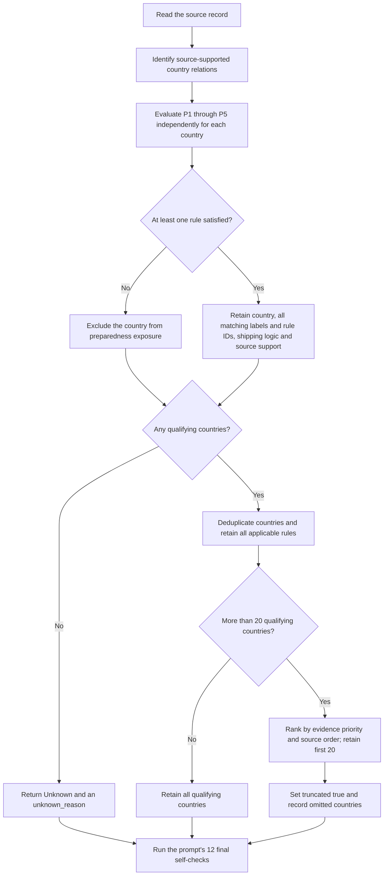

# Preparedness-exposure mapping rules

The full author-confirmed prompt is preserved verbatim in [preparedness_mapping_rules.txt](preparedness_mapping_rules.txt). This page provides a navigation table and a workflow summary. The full prompt governs the assignments.

## Country roles

| Field | Role | Inclusion requirement |
| --- | --- | --- |
| `occurrence_countries_strict` | Reported risk origin | The source explicitly locates the triggering event in the country. |
| `directly_affected_countries` | Documented exposure | The source explicitly documents an operational, commercial, regulatory, logistics or supply-chain consequence. |
| `shipping_network_affected_countries` | Preparedness exposure | The source establishes a country relationship satisfying at least one of P1–P5. |

Preparedness exposure is an analytical scenario relation. It does not establish observed disruption, realised loss or cross-border propagation.

## Rule index

| ID | Mechanism | Output label | Required source relationship |
| --- | --- | --- | --- |
| P1 | Trade-lane exposure | `trade_lane_exposure` | An identifiable affected route or service, with a source-supported country endpoint or an explicit link to its ports, cargo, carriers, exporters, importers or market. |
| P2 | Rerouting exposure | `rerouting_exposure` | Explicit rerouting or diversion and a country relation through service endpoints, involved ports, diverted traffic, or source-reported rerouting implications. |
| P3 | Chokepoint exposure | `chokepoint_exposure` | An affected chokepoint and an explicit country relation through trade flows, ports, services, vessels, cargo, markets or national preparedness implications. |
| P4 | Port-substitution exposure | `port_substitution_exposure` | A source-identified alternative port or country port system, shifted traffic, or an explicit country link to the substitution response. |
| P5 | Trade-flow or shipping-market exposure | `trade_flow_exposure` | A source-supported country link to the affected trade flow, exporters, importers, shipping market, port system, capacity, freight rates or trade relation. |

## Decision workflow

## Evidence and list handling

- Each preparedness country requires a label, rule ID, trigger type, short country-specific explanation, and supporting source phrase or source-supported context.
- Evaluate P1–P5 independently. List each country once and retain every matching label and rule ID.
- Generic regional expressions, economic importance, geographical proximity and general maritime knowledge do not independently qualify a country.
- A country may appear in several geographical layers when the corresponding source requirements are satisfied.
- When more than 20 countries qualify, prioritize explicitly named country relations, then explicit links through ports, firms, cargo flows or national markets, then qualifying relations supported by the broader source-described context. Country-level identification remains required at every priority.
- Within each priority, preserve the order in which the supporting relations appear in the source. Record `truncated` and `truncated_countries` when the cap removes qualifying countries.
- Return `["Unknown"]` alone when no defensible country can be assigned. A preparedness result with no country relation also requires `unknown_reason`.

## Output and version correspondence

The full prompt specifies `preparedness_exposure` entries with `country`, `labels`, `rule_ids`, `trigger_type`, `evidence` and `source_phrase`, together with `scenario_type`, `rule_trace`, `truncated`, `truncated_countries` and `unknown_reason`.

The earlier script-extracted prompt in `user_prompt_template.txt` uses `direct_affected_countries` and role-level `country_evidence`. The author-confirmed specification uses `directly_affected_countries` and country-level preparedness evidence. The two formats require an explicit adapter if used together. The existing `country_mapping_prompt.py` continues to render the earlier script prompt; adding this specification does not change that code or any stored study outputs.
