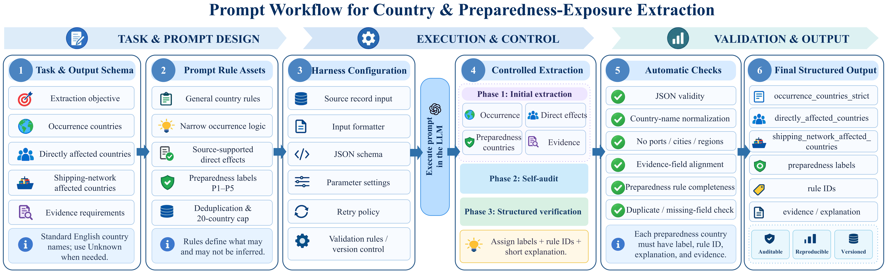

# ANCHOR preparedness-exposure mapping

Country-role definitions, P1–P5 preparedness-exposure rules, evidence requirements and prompt assets for shipping-risk records.

## Workflow schematic



The author-provided schematic illustrates task and prompt design, execution and control, and validation and structured output. It links the country-role definitions, P1–P5 rule assets, evidence requirements, extraction stages and output fields. The full-resolution image is available as [preparedness_mapping_workflow.png](preparedness_mapping_workflow.png).

## Author-confirmed mapping specification

- [preparedness_mapping_rules.txt](preparedness_mapping_rules.txt): complete author-supplied prompt, preserved verbatim.
- [PREPAREDNESS_MAPPING_RULES.md](PREPAREDNESS_MAPPING_RULES.md): country-role table, P1–P5 rule index, decision flowchart, evidence requirements and output-format correspondence.
- [prompt_provenance.json](prompt_provenance.json): source description, file digest and relationship to the earlier script-extracted release.

The five preparedness relationships are trade-lane exposure, rerouting exposure, chokepoint exposure, port-substitution exposure and trade-flow or shipping-market exposure. Every preparedness country requires a source-supported country relation, at least one rule ID and label, a shipping explanation, and supporting source evidence or context. The prompt also specifies deduplication, unknown handling, the 20-country evidence-priority rule and twelve final self-checks.

Preparedness exposure represents an analytical scenario relation. Inclusion does not establish observed disruption, realised loss or cross-border propagation.

The prompt, mapping rules and workflow schematic are documented directly in this repository.

## Earlier script-extracted prompt and request builder

The first repository release, [commit ede5d9034526](https://github.com/fzx0406/anchor-preparedness-mapping/tree/ede5d9034526e2e0f3afda056e2d5fcdad7e2aa0), contains the prompt extracted from `expand_shipping_country_impacts_deepseek.py`. These files remain available for tracing that implementation:

- `country_mapping_prompt.py`: script-extracted prompt-construction function and standalone request renderer.
- `system_prompt.txt`: system instruction used by that renderer.
- `user_prompt_template.txt`: earlier script-extracted user prompt.
- `input_template.json`: placeholder input batch for that renderer.

The author-confirmed specification uses `directly_affected_countries` and country-level `preparedness_exposure` entries. The earlier script uses `direct_affected_countries` and role-level `country_evidence`. Its broader country-inference instructions and list-processing fallbacks must be distinguished from the P1–P5 specification. The existing renderer preserves its original behavior and does not implement the new output format or the P1–P5 checks.

## Rendering the earlier request

Python 3.9 or later is sufficient; the renderer uses only the standard library.

```bash
python country_mapping_prompt.py --input input_template.json --model YOUR_ACTUAL_MODEL_ID --output request.json
```

This writes the earlier JSON request payload and makes no model API call. The model identifier is explicit. The request uses `temperature=0.0`, JSON-object formatting, a default 2,200-character input-text limit and a default 10,000-token output limit. The renderer collapses whitespace and appends ` ...` after truncation.

The publication of a prompt specifies the rules available for inspection and reuse. Reconstructing study counts additionally requires the applicable run configuration, frozen record-level assignments and aggregation procedure.
